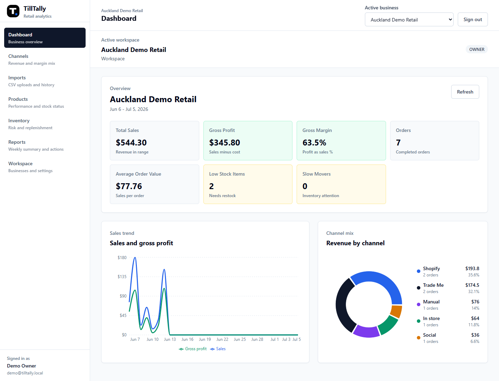
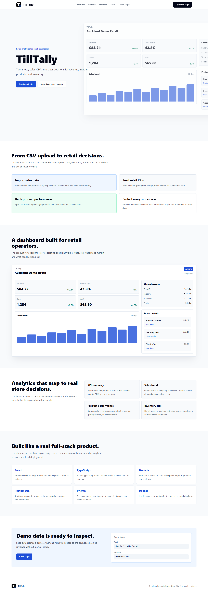
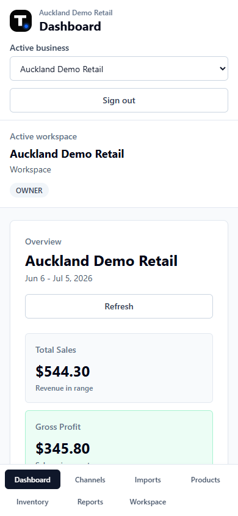
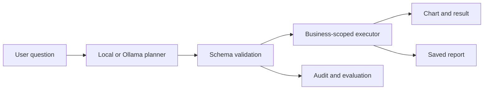
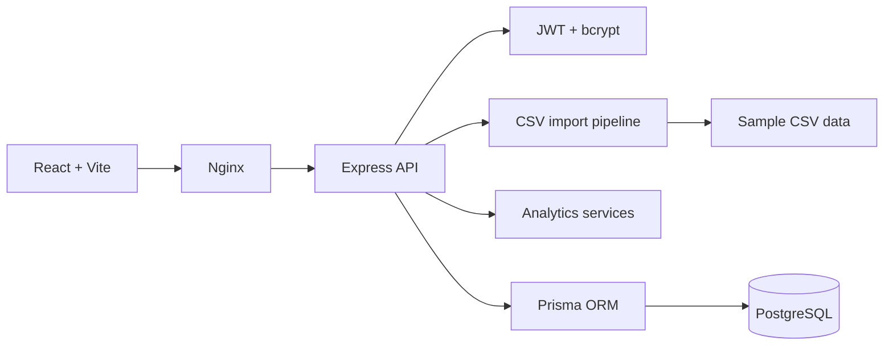

# TillTally

[](https://github.com/hannnnnnnny/till-tally/actions/workflows/ci.yml)


[](LICENSE)

Retail analytics without enterprise BI complexity. TillTally turns familiar CSV exports into revenue, margin, product, inventory and channel insights for small retailers, charity shops and independent e-commerce sellers.

It is built around five practical questions:

1. How much did we sell?
2. How much gross profit did we make?
3. Which products performed best?
4. Which products need inventory action?
5. Which sales channels are working best?

## Product Preview



<table>
  <tr>
    <td width="67%">
      
      <br /><strong>Product landing page</strong>
    </td>
    <td width="33%">
      
      <br /><strong>Mobile dashboard</strong>
    </td>
  </tr>
</table>

## Why TillTally?

Small retailers often have useful sales and inventory data but lack the time, specialist skills or budget required for a traditional business-intelligence platform. TillTally provides a focused workflow from raw exports to operational decisions:

- **Import familiar files** instead of building integrations first.
- **Validate before committing** with previews, header aliases and row-level corrections.
- **Translate transactions into decisions** through KPIs, rankings and risk labels.
- **Keep each business isolated** through workspace-scoped access control.
- **Make analytics explainable** with deterministic calculations and explicit report outputs.

## Core Capabilities

| Area | What TillTally provides |
| --- | --- |
| Dashboard | Revenue, gross profit, margin, orders, AOV, units and inventory-risk KPIs |
| Sales analysis | Time-series trends and channel-performance breakdowns |
| Product performance | Product rankings, contribution measures and actionable status labels |
| Inventory risk | Low-stock, stockout, slow-mover, dead-stock and overstock detection |
| CSV imports | Preview, column mapping, aliases, row validation, inline row correction and import history |
| Reporting | Weekly summaries with top products, warnings and suggested actions |
| Analytics planner | Natural-language questions converted into validated analytics plans |
| Saved analysis | Persisted reports and auditable analytics activity |
| Workspaces | Authentication and per-business data isolation |
| Responsive UI | Desktop and mobile workflows with accessibility checks |

## Analytics Planner

TillTally includes a deterministic, model-free analytics planner that works locally by default. Natural-language requests are converted into a constrained analytics plan, schema-validated, executed against business-scoped data and recorded for auditability.

An optional private Ollama model can improve phrasing, but it is not required for normal operation. Provider output cannot execute directly: it must pass the same validation contract before becoming an analytics plan.



## Architecture

TillTally is an npm-workspaces monorepo with separate frontend, API and shared analytics-contract packages.



| Layer | Technology |
| --- | --- |
| Frontend | React 18, TypeScript, Vite, Tailwind CSS, Recharts |
| Backend | Node.js, Express, TypeScript |
| Database | PostgreSQL 16, Prisma ORM |
| Authentication | JWT, bcrypt, httpOnly refresh cookies |
| Data import | Multer, csv-parse, Papa Parse |
| Analytics | Deterministic planner, shared contracts, optional Ollama provider |
| Testing | Node test runner, Supertest, Playwright, axe-core |
| Delivery | GitHub Actions, Docker Compose, Nginx |

## Demo Workspace

Seed the included sample data to create a portfolio-ready local workspace:

```text
Email: demo@tilltally.local
Password: DemoPass123!
Workspace: Auckland Demo Retail
```

These credentials are for the locally seeded demonstration environment only.

## Getting Started

### Prerequisites

- Node.js 20 or later
- npm 10 or later
- Docker Desktop or Docker Engine with Docker Compose

### Install

```bash
git clone https://github.com/hannnnnnnny/till-tally.git
cd till-tally
npm install
```

Copy the local environment templates:

```bash
cp server/.env.example server/.env
cp client/.env.example client/.env
```

Generate separate JWT secrets and add them to `server/.env`:

```bash
openssl rand -hex 32
```

> [!IMPORTANT]
> Environment files and generated secrets must not be committed. Development defaults in Docker Compose are not suitable for production.

### Start PostgreSQL

```bash
docker compose up -d db
docker compose ps
```

### Apply Migrations and Seed the Demo Data

```bash
npm run db:migrate
npm run db:seed
```

The seed creates the demo user and workspace with a deterministic 12-week dataset generated relative to the seeding day: about 160 orders across five channels, weekly inventory snapshots, and products tuned so every inventory-risk category (low stock, stockout risk, slow mover, dead stock, overstock) appears. It also generates the weekly report for the last complete week. The files in `sample-data/` are example CSVs for trying the import workflow.

Production seeding is blocked unless `ALLOW_PRODUCTION_SEED=true` is deliberately enabled for a one-off reset.

### Run in Development

Run the API and client in separate terminals:

```bash
npm run dev:server
npm run dev:client
```

| Service | URL |
| --- | --- |
| Client | <http://localhost:5173> |
| API health check | <http://localhost:4000/api/health> |

### Run the Full Stack with Docker

The API container does not run migrations on start, so apply migrations and seed first (steps above) when using a fresh database volume.

```bash
docker compose up -d --build
```

| Service | URL |
| --- | --- |
| Client | <http://localhost:8080> |
| API health check | <http://localhost:4000/api/health> |
| PostgreSQL | `localhost:5432` |

Host ports are configurable with `POSTGRES_PORT`, `SERVER_PORT` and `CLIENT_PORT`, and container names follow the Compose project, so a second checkout can run alongside the first:

```bash
POSTGRES_PORT=55432 SERVER_PORT=4100 CLIENT_PORT=8081 docker compose -p tilltally-review up -d --build
```

To stop the stack while retaining database data:

```bash
docker compose down
```

To remove the local database volume as well:

```bash
docker compose down -v
```

## Optional Ollama Configuration

The local planner requires no model service. To use an optional Ollama provider, run Ollama separately and configure these server-only values:

```env
ANALYTICS_PLANNER_PROVIDER=ollama
OLLAMA_BASE_URL=http://127.0.0.1:11434
OLLAMA_MODEL=qwen3:4b
```

Model configuration stays on the server and is never exposed to the React client.

## Development Workflow

| Command | Purpose |
| --- | --- |
| `npm run dev:client` | Start the Vite development server |
| `npm run dev:server` | Start the Express API with hot reload |
| `npm run build` | Build shared contracts, client and server |
| `npm run db:migrate` | Apply Prisma migrations to the database in `server/.env` |
| `npm run db:seed` | Seed the demonstration workspace |
| `npm run prisma:generate` | Regenerate the Prisma client after pulling schema changes (`npm install` does this on a fresh clone) |
| `npm run typecheck` | Type-check all workspaces and E2E tests |
| `npm run lint` | Run ESLint |
| `npm run format:check` | Verify Prettier formatting |
| `npm test --workspaces --if-present` | Run workspace test suites |
| `npm run test:integration -w server` | Run API integration tests against a disposable PostgreSQL database (`INTEGRATION_DATABASE_URL`; wipes all tables) |
| `npm run test:e2e` | Run Playwright browser tests against a mocked API (UI states, 375px layout, axe) |
| `npm run test:e2e:fullstack` | Run the demo journey against the real API and PostgreSQL (`E2E_DATABASE_URL`; migrates and re-seeds it) |
| `npm run test:analytics-evals -w server` | Run analytics-planner evaluations |

The CI workflow runs formatting, Prisma validation, linting, type-checking, analytics evaluations, unit tests, PostgreSQL-backed integration tests (imports, KPIs and workspace isolation), mocked and full-stack Playwright tests and production builds on pushes and pull requests to `main`.

## Monorepo Structure

```text
till-tally/
├── client/                 # React, Vite and Tailwind frontend
├── server/                 # Express API, Prisma and domain services
├── packages/
│   └── analytics-contracts # Shared planner and result contracts
├── sample-data/            # Demonstration CSV exports
├── docs/                   # API, database, deployment and evaluation docs
├── scripts/                # Demo and development utilities
├── .github/workflows/      # Continuous integration
└── docker-compose.yml      # Local full-stack environment
```

## Security and Privacy

- Passwords are hashed with bcrypt before storage.
- Refresh tokens use httpOnly cookies; access tokens are short-lived.
- Every business-scoped request verifies workspace membership.
- Rate limiting and content-security headers protect API and browser surfaces.
- CSV uploads enforce type and size limits, generated filenames and stripped paths.
- Import templates avoid customer PII such as names, emails, addresses and payment details.
- Analytics plans are validated before execution and recorded for auditability.

## Documentation

| Document | Contents |
| --- | --- |
| [Product](PRODUCT.md) | Users, purpose, design principles and accessibility goals |
| [API](docs/API.md) | Endpoints, request/response shapes, errors and authentication |
| [Database](docs/DATABASE.md) | Schema, ERD, Prisma models, indexes and isolation rules |
| [Analytics evaluations](docs/ANALYTICS_EVALUATIONS.md) | Planner evaluation cases and quality checks |
| [Deployment](docs/DEPLOYMENT.md) | Ubuntu, Docker Compose, Nginx, HTTPS, backups and releases |

## Product Scope

TillTally is an analytics and decision-support tool, not a point-of-sale system or accounting platform. CSV imports cover orders (optionally with line items) and products; stock levels come from the products file's `current_stock` column. Inventory snapshot files can be previewed in the importer but not imported. Imported figures depend on the completeness and accuracy of the source CSV files. Inventory warnings and suggested actions should be reviewed by the business operator before use.

## Roadmap

Development work is tracked on the [TillTally project board](https://github.com/users/hannnnnnnny/projects/2), covering foundation, authentication, workspaces, importing, analytics, frontend, reporting and deployment.

## Licence

TillTally is licensed under the [MIT Licence](LICENSE).

---

Designed and developed by [Harry Han](https://github.com/hannnnnnnny).
